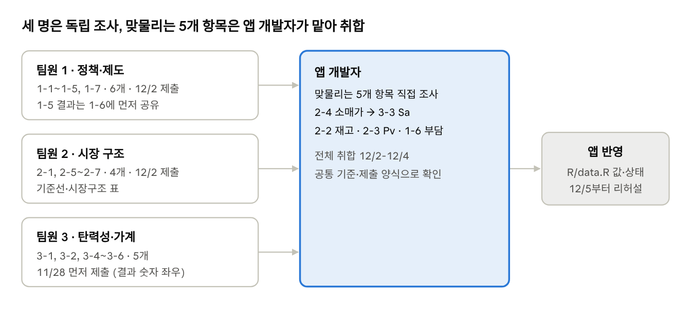

# 원유가격 시뮬레이터 자료조사 기준과 역할 분담

작성일 2026-11-23 · 원본(편집·댓글용): [Claude 문서](https://claude.ai/artifact/Bh9cvCCWQGwG6CfZzqTc1w)

> 이 파일은 2026-11-23 시점의 사본입니다. 원본 문서를 고치면 이 파일은 자동으로 바뀌지 않습니다.

## 개요

앱의 계산 모형과 화면은 완성됐고, 남은 일은 임시 값으로 채워 둔 자료 20개 항목을 실제 출처로 바꾸는 것입니다. 팀원 3명이 서로 독립적인 15개 항목을 나눠 조사하고, 서로 값을 주고받아야 하는 5개 항목은 앱 개발자가 이 문서의 기준대로 직접 조사한 뒤 전체를 취합해 앱에 반영합니다.

- 앱: [원유가격 정책 시뮬레이터](https://sappheiros009.github.io/raw-milk-price-simulator/)
- 각자 맡은 항목은 담당별 표에, 지켜야 할 기준과 제출 양식은 "공통 기준"에 있습니다.

**일정**

1. 팀원 3 탄력성·가계 항목 제출: 2026-11-28 (앱의 결과 숫자가 이 값으로 바뀌므로 먼저)
2. 나머지 항목 제출: 2026-12-02
3. 앱 개발자 취합·앱 반영: 12/2-12/4
4. 리허설과 시연 녹화: 12/5-12/7
5. 발표: 2026-12-08, 2026-12-10
6. 정책 브리프 제출: 2026-12-18

## 역할 분담 한눈에

팀원 3명의 조사는 서로 독립이라 다른 사람을 기다릴 필요가 없습니다. 앱 개발자만 팀원 1의 1-5 결과를 받아 1-6 판단에 씁니다.

## 공통 기준

모든 값은 아래 기준에 맞춰 찾아야 앱에 바로 넣을 수 있고, 팀원끼리 값이 어긋나지 않습니다.

| 항목 | 기준 |
| --- | --- |
| 기준연도 | 2013년. 가능하면 도입 전(1-7월)과 도입 후(8-12월)를 구분. 다른 연도 값밖에 없으면 비고에 적기 |
| 단위 | 가격 원/L, 수량 천 톤, 금액 원. 원유 1톤 ≈ 1,000L로 환산(앱의 가정, 실제 밀도로는 약 3% 차이) |
| 시장 단계 | 원유(농가 출하)·가공·소매 중 어느 단계의 값인지 반드시 표시 |
| 출처 우선순위 | 공공 통계(낙농진흥회, KOSIS, KAMIS·참가격, 관세청) → 연구기관·논문(KREI 등) → 언론 보도. 언론만 있으면 두 곳 이상 교차 확인 |
| 원문 확인 | 검색 요약이 아니라 원문을 열어 확인하고, 해당 쪽을 캡처해 첨부 |
| 못 찾은 경우 | "못 찾음"과 찾아본 곳을 적기. 앱에는 "확인 필요"로 남기고 브리프의 한계에 기재 |
| AI 사용 | 쓴 도구, 프롬프트, 날짜, 발견한 오류를 기록(브리프 부록 AI 활용 명세의 재료) |

**제출 양식** — 항목마다 한 줄씩 채워서 냅니다.

| 항목 번호 | 값 | 단위 | 연도·시점 | 시장 단계 | 출처(기관·문서명) | URL | 조회일 | 비고 |
| --- | --- | --- | --- | --- | --- | --- | --- | --- |
| 예: 3-5 | (값) | % | 2013 | 소매 | 통계청 가계동향조사 | (주소) | (날짜) | 소득 1분위 우유 지출 비중 |

## 팀원 1: 정책·제도 (6개, 12/2 제출)

정책·시장 탭의 정책 개요와 추이 그래프에 들어갑니다. 1-5의 쿼터 초과 원유 가격은 앱 개발자의 1-6 판단에도 쓰이므로 찾는 대로 먼저 공유합니다.

| 번호 | 조사 항목 | 앱 위치 | 찾을 곳 |
| --- | --- | --- | --- |
| 1-1 | 연동제 산출 공식 원문(기준원가·변동원가 정의, 매년 적용 시점) | 정책 개요 "작동 방식" | 농림축산식품부 보도자료, 낙농진흥회 |
| 1-2 | 도입 배경과 결정 시점(2011년 협상 갈등 → 제도 결정 연도 → 2013년 8월 첫 적용) | 정책 개요 "목표" | 농림축산식품부, 당시 언론 보도 |
| 1-3 | 연도별 원유 기본가격과 인상폭(2013-2025, 동결·인하 포함) | 정책 개요 "규모와 변화" | 낙농진흥회, 언론 보도 교차 확인 |
| 1-4 | 2023년 용도별 차등가격제(음용유·가공유 가격, 시장 상황 반영 방식) | 추이 그래프의 "(확인 필요)" 표시 | 농림축산식품부 보도자료 |
| 1-5 | 쿼터제: 도입 연도, 2013년 쿼터 총량, 쿼터 초과 원유 정산 가격 | 정책 개요 "한계", 모형 한계 | 낙농진흥회 |
| 1-7 | 우유 생산비(2012-2013년, 원/L) | 출처 표 "우유 생산비" | KOSIS 축산물생산비조사 |

## 팀원 2: 시장 구조 (4개, 12/2 제출)

정책·시장 탭의 기준선 표와 시장구조 표에 들어갑니다. 2-5의 시장집중도는 "경쟁 가정이 타당한가"에 답하는 근거라 강의 L12(시장지배력)와 연결됩니다.

| 번호 | 조사 항목 | 앱 위치 | 찾을 곳 |
| --- | --- | --- | --- |
| 2-1 | 2013년 유업체 원유 구매량(음용유용·가공유용, 천 톤) | 기준선 표 | 낙농진흥회 낙농통계광장 |
| 2-5 | 유업체 시장집중도 CR4 또는 HHI(서울우유·남양·매일 등 점유율, 연도 명시) | 시장구조 표 "구매자 집중도", "경쟁 가정의 타당성" | 공정거래위원회, KREI 보고서, 업계 점유율 보도 |
| 2-6 | 유제품 수입량(치즈·분유, 2012-2015년)과 FTA 관세 철폐 일정 | 시장구조 표 "원유 무역", "국경 조치" | 관세청 수출입무역통계, FTA 포털 |
| 2-7 | 원유 저장 가능 기간, 원유 자체의 교역 여부 | 시장구조 표 "저장성" | 낙농진흥회, KREI |

## 팀원 3: 탄력성·가계 (5개, 11/28 제출)

시뮬레이터와 후생 결과의 숫자가 모두 이 값으로 바뀌므로 가장 먼저 제출합니다. 괄호 안은 지금 앱에 들어 있는 임시 값입니다.

| 번호 | 조사 항목 | 앱 위치 (임시 값) | 찾을 곳 |
| --- | --- | --- | --- |
| 3-1 | 원유 공급탄력성 ε, 단기·장기 | 탄력성 표 (0.2 / 0.8) | KREI 보고서, 국내 축산경제 논문 |
| 3-2 | 흰 우유 소매 수요탄력성 η | 탄력성 표 (−0.3 / −0.5) | KREI, 국내 우유 수요 추정 논문 |
| 3-4 | 원유와 다른 투입재 간 대체탄력성 σ | 탄력성 표 (0.3) | 문헌. 없으면 범위만 제시 |
| 3-5 | 2013년 소득 1분위·5분위의 우유 지출 비중 | 가계 파급 효과 (1.0% / 0.4%) | 통계청 가계동향조사 (KOSIS) |
| 3-6 | 2013년 소득 1분위·5분위 월평균 소비지출 | 가계 파급 효과 (120만 / 500만 원) | 통계청 가계동향조사 (KOSIS) |

**탄력성 기록 기준**

- 값마다 타당 범위, 출처, 시장 단계(농가/소매), 단기·장기 구분을 함께 적습니다. 과제가 이 형식의 표를 요구합니다.
- η는 흰 우유(시유)의 자체 가격탄력성, 일반(Marshall) 탄력성을 씁니다. 국내 추정치를 우선하고 해외 값은 보조 근거로만 씁니다.
- 문헌이 "우유 전체"나 "유제품" 기준이면 쓰되, 비고에 범위가 다르다고 적습니다.
- 단기·장기는 공급탄력성 ε로 구분합니다. 문헌이 η를 나누지 않으면 η는 한 값만 적습니다(앱에서 단기·장기에 같은 값 사용).
- 국내 문헌이 없으면 L8 실습 방법으로 한국 우유 소비량·가격 자료를 넣어 직접 추정해도 됩니다.

## 앱 개발자: 맞물리는 5개 항목과 기준

아래 5개는 서로 값을 주고받거나 같은 자료에서 나오므로 앱 개발자가 직접 조사합니다. 순서는 2-4 소매가를 먼저 정하고 3-3 Sa를 계산한 뒤, 2-2·2-3·1-6을 함께 봅니다.

### 2-4 흰 우유 소매가격

- 기준: 흰 우유 1L(900ml 제품은 1L로 환산), 대형마트 판매가, 2013년 1-7월 평균. 모형의 P*와 같은 기간이어야 하기 때문입니다. 도입 후 가격은 비교용으로만 기록합니다.
- 출처 순서: KAMIS에 우유 1L 품목이 있으면 KAMIS, 없으면 한국소비자원 참가격, 둘 다 없으면 업체 발표가를 두 곳 이상 교차 확인. 소비자물가지수는 지수라 쓸 수 없습니다.
- 흰 우유는 부가세 면세 품목이라 세금 조정은 하지 않습니다.
- 참고: 보도상 인상 전 대형마트 1L 가격은 2,300-2,350원대입니다(원자료로 확인 필요).
- 맞물리는 곳: 3-3 Sa의 분모, 팀원 3의 3-2 η가 가리키는 제품 범위.

### 3-3 소매가 중 원유 몫 Sa

- 기준: Sa = 원유수취가격 P*(980.29원/L) ÷ 2-4 소매가. 앱의 다른 계산이 수취가격 기준이라 기본가격(834원)은 쓰지 않습니다.
- 가정: 원유 1L로 흰 우유 약 1L를 만든다고 봅니다.
- 같은 시기의 KREI 등 문헌값이 있으면 검산용으로 함께 적습니다.
- 주의: 이 계산이면 앱의 소매가 변화가 원유가 인상액과 원 단위로 같아집니다(유통 마진 고정). 2013년에는 원유가 106원 인상에 소매가 220-250원 인상이 추진됐으므로, 이 차이를 한계 또는 시장지배력의 근거로 브리프에 씁니다.

### 2-2 잉여 원유 재고

- 기준: 낙농진흥회의 우유 재고량(원유 환산, 톤), 연말 기준 2012-2015년.
- 모형과 비교할 때는 재고 수준이 아니라 연말 재고의 전년 대비 증가분(1년 동안 남은 양)을 씁니다. 모형의 잉여도 1년 양입니다.
- 참고: 보도상 2013년 약 9.3만 톤, 2014년 약 23.2만 톤(주간경향, 낙농진흥회 집계 인용). 원자료로 확인 필요.
- 한계: 2013년 말 재고가 이미 있었다는 점은 "도입 전에는 남는 원유가 없다"는 모형 가정과 충돌합니다. 재고 증가에는 FTA 수입, 날씨, 소비 감소도 섞여 있습니다.

### 2-3 잉여 원유 처분가치 Pv

- 기준: 순회수가치 = (분유·버터 판매 수입 − 가공비 − 보관비) ÷ 들어간 원유 L.
- 앱 기본값은 0(강의 모형의 "회수 가치 없음")을 유지하고, 구한 값은 비교 시나리오로 씁니다.
- 비용이 수입보다 크면 음수일 수 있고, 그때 사중손실은 Pv = 0일 때보다 커집니다.
- 맞물리는 곳: 1-6과 같은 자료(2014-2015년 재고 처리 보도·예산)에서 나옵니다.

### 1-6 잉여 처리 비용 부담 주체

- 확인할 것: 정부의 재고 처리 예산 지원 여부와 금액, 쿼터 초과 원유 정산 방식(팀원 1의 1-5), 협동조합(서울우유)이라 유업체 부담이 조합원 농가에게 돌아가는 구조.
- 앱 기본값은 "정부 매입"(강의 L11 공식과 바로 비교 가능)을 유지하고, "유업체 매입"은 현실 시나리오로 보여줍니다. 조사 결과에 따라 브리프에 "유업체 부담 + 정부 일부 지원" 등으로 서술합니다.
- 모형 한계: 앱은 농가가 생산한 원유 전부를 연동제 가격에 판다고 봅니다. 쿼터 초과분은 더 낮은 가격을 받으므로 모형이 공급 반응을 크게 잡을 수 있습니다.

## 바로잡은 내용

앞서 Claude가 대화에서 설명한 내용 중 틀린 4가지를 고쳤고, 근거가 약했던 기준 5가지를 바꿨습니다. 이 문서의 기준은 모두 고친 내용을 따릅니다.

**틀린 주장**

| 앞선 주장 | 고친 내용 |
| --- | --- |
| 부담 주체를 유업체로 바꾸면 첫 화면의 유업체 손실이 처리 비용만큼 커진다 | 첫 화면 "유업체가 잃는 몫"은 부담 주체와 상관없이 ΔCS만 보여줌. 바뀌는 것은 후생 결과 탭의 행 이름뿐(앱 개선 대상) |
| 처분가치 Pv = 0이면 사중손실의 상한 | 가공·보관비가 판매 수입보다 크면 순회수가치가 음수가 되어 사중손실이 더 커짐. Pv = 0은 "회수 가치 없음" 가정일 뿐 |
| 2013년 서울우유가 흰 우유를 220원 올렸다 | 220원 인상은 매일유업 사례로도 보도됨. 서울우유는 2,300원에서 2,550원 인상을 추진하다 잠정 유보했다는 보도가 있음. 미확정, 2-4에서 확인 |
| 출처 "인포스탁데일리(inews24)" | 아이뉴스24. 또 숫자와 기사의 짝은 검색 요약 기준이라 원문 확인이 필요 |

**근거가 약해 바꾼 기준**

| 이전 기준 | 바꾼 기준 |
| --- | --- |
| 도입 후 소매가를 쓰면 안 되는 이유는 "인상 유보 보도" | 진짜 이유는 모형의 P*와 같은 기간(2013년 1-7월)이어야 하기 때문 |
| 문헌이 η를 나누지 않으면 단기 값으로 둠 | 단기·장기는 공급탄력성 ε로만 구분. η는 두 기간에 같은 값 |
| Pv = 수입 탈지분유 가격의 원유 환산값 | 순회수가치 = (분유·버터 판매 수입 − 가공·보관비) ÷ 원유 L |
| 모형 잉여와 재고량을 비교 | 연말 재고의 전년 대비 증가분과 비교(둘 다 1년 양) |
| 앱 기본 부담 주체를 유업체로 바꾸자 | 철회. 정부 매입 유지, 1-6 조사 후 서술 결정 |

## 앱 반영 계획

취합이 끝나면 앱 개발자가 12/2-12/4에 아래를 반영합니다.

- [ ] 제출된 값을 R/data.R에 넣고 상태를 "확인 완료"로 변경
- [ ] 단기·장기 프리셋에서 η를 같은 값으로 (단기·장기는 ε로만 구분)
- [ ] 유업체 매입을 고르면 유업체 총부담(ΔCS + 처리 비용)이 화면에 보이게
- [ ] Sa를 2-4 소매가 기준으로 다시 계산하고, 2013년 실제 전가율과 비교하는 문구 추가
- [ ] 2-2 재고 증가분과 모형 잉여를 "실제와 비교"에 추가
- [ ] 모형 한계(도입 전 재고 존재, 쿼터 초과 원유 가격)를 방법론 탭에 기재

## 참고 출처

기준을 정할 때 검색으로 참고한 자료입니다. 숫자를 앱에 넣기 전에 원문을 다시 확인해야 합니다.

- 강의 L11 Supply Policy 6쪽(팀 공유 드라이브): 가격지지 면적 공식 (앱 검증 기준)
- [머니투데이: 매일유업 우윳값 인상 (2013.7)](https://www.mt.co.kr/article/2013072913001652225): 인상 전 1L 2,350원
- [머니투데이: 8월부터 원유가격 12.7% 인상 (2013.6)](https://www.mt.co.kr/stock/2013/06/13/2013061218410151313): 기본가격 834원에서 940원
- [아이뉴스24 (2013)](https://www.inews24.com/view/763240)
- [주간경향: 우유 재고 급증 (2015.10)](https://weekly.khan.co.kr/article/201510281016491): 재고 2013년 약 9.3만 톤, 2014년 약 23.2만 톤
- [IB토마토: 원유 쿼터제와 과잉 공급](https://ibtomato.com/View.aspx?no=18828&type=1)
- [비즈워치: 흰우유 면세, 딸기우유 과세 (2016)](https://news.bizwatch.co.kr/article/tax/2016/12/21/0032)
- [공공데이터포털: KAMIS 농수축산물 가격 연계데이터](https://www.data.go.kr/data/1043837/linkedData.do)
